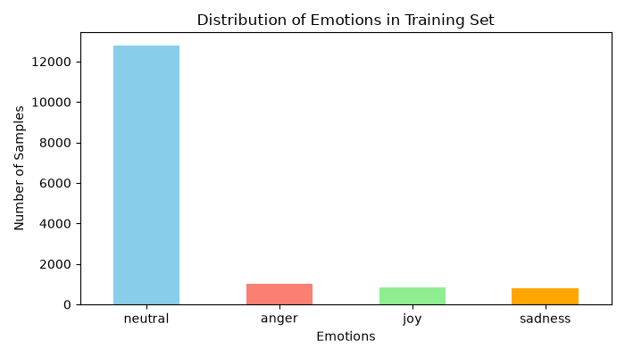
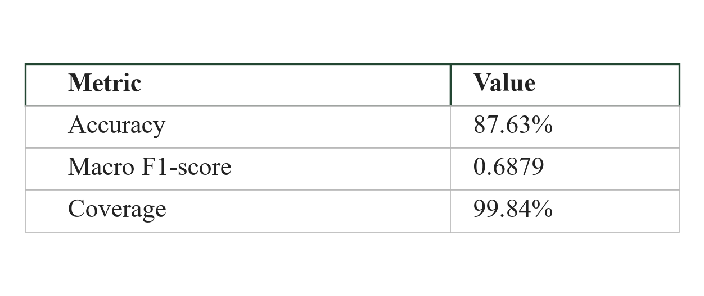
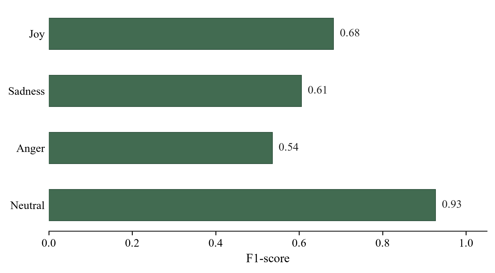
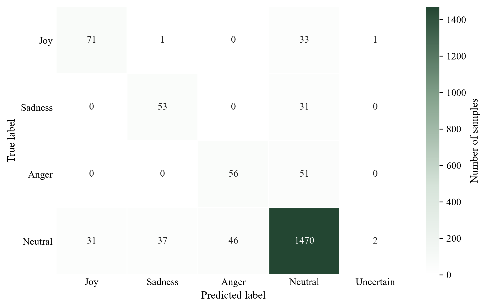

# Emotion Classification — Logistic Regression from Scratch


A multiclass text emotion classifier implemented from scratch using Python and NumPy.

I started this project to understand Logistic Regression at the implementation level rather than relying on a ready-made classifier. I implemented the learning algorithm, experimented with training configurations, evaluated its performance, and investigated how individual words influence its predictions.

The project includes model implementation, dataset preparation, training experiments, evaluation results, and model interpretation.

## 1. Project Overview

The model classifies English text into four emotion categories:

- Joy
- Sadness
- Anger
- Neutral

### Classification Pipeline

**Text → TF-IDF Features → Logistic Regression → Softmax Probabilities → Prediction**

The Logistic Regression classifier is implemented from scratch using NumPy.

Scikit-learn is used for feature extraction, cross-validation, and evaluation metrics, but not for implementing or training the classifier itself.

## 2. Dataset

This project uses the [GoEmotions dataset](https://huggingface.co/datasets/google-research-datasets/go_emotions) developed by Google Research.

The dataset contains Reddit comments annotated with emotion labels. I used the `simplified` configuration and selected four emotion categories.

### Data Preparation

The `prepare_data.py` script performs the following steps:

1. Retain examples containing exactly one emotion label.
2. Filter examples to the four selected emotions.
3. Convert text to lowercase and normalize whitespace.
4. Remove empty text entries.
5. Remove examples with conflicting labels within each split.
6. Remove duplicate texts within each split.
7. Remove overlapping texts between training, validation, and test sets.

The processed dataset is saved as:

- `data/train.csv`
- `data/val.csv`
- `data/test.csv`

### Class Distribution

| Emotion | Training | Validation |
|---|---:|---:|
| Joy | 845 | 106 |
| Sadness | 815 | 84 |
| Anger | 1,021 | 107 |
| Neutral | 12,792 | 1,586 |
| **Total** | **15,473** | **1,883** |



**Figure 1.** Distribution of emotion labels in the training set.

The dataset is highly imbalanced, with Neutral representing the majority of examples.

This creates a challenge because a classifier can achieve relatively high accuracy by frequently predicting the majority class while performing poorly on minority classes.

To address this issue, I experimented with class weighting and used Macro F1-score alongside accuracy.

## 3. Model Implementation

The Logistic Regression classifier is implemented in `LR.py`.

### Forward Pass

The model first computes linear scores:

$$
Z = XW + b
$$

where:

- \(X\) represents the input feature matrix.
- \(W\) represents the model weights.
- \(b\) represents the bias terms.

The scores are converted into class probabilities using the softmax function:

$$
P(y=k\mid x)=\frac{e^{z_k}}{\sum_j e^{z_j}}
$$

### Loss Function and Optimization

Training uses weighted cross-entropy loss and gradient descent.

The training procedure consists of:

1. Computing the linear scores.
2. Applying softmax to obtain class probabilities.
3. Calculating the weighted cross-entropy loss.
4. Computing gradients for the weights and biases.
5. Updating model parameters using the learning rate.
6. Repeating the process for the specified number of epochs.

Class weighting is used to reduce the effect of the imbalanced class distribution during training.

### Confidence Threshold

The classifier also supports a confidence threshold.

If the highest predicted softmax probability is below the selected threshold, the model returns `-1`, representing an **Uncertain** prediction.

This allows the classifier to abstain from assigning an emotion when its confidence score is relatively low.

### Feature Extraction

Text is represented using TF-IDF features.

| Parameter | Value |
|---|---|
| Vectorizer | TF-IDF |
| `min_df` | 2 |
| `max_features` | 5,000 |
| Normalization | L2 |

The TF-IDF representation transforms text into numerical features that can be processed by the Logistic Regression classifier.

## 4. Training and Experiments

I experimented with different configurations to understand how training parameters affect model performance.

The experiments included:

- Learning rate
- Number of epochs
- Class weighting
- Confidence threshold
- Feature extraction settings

I also used stratified 5-fold cross-validation to compare configurations while preserving the class distribution across folds.

### Final Training Configuration

| Parameter | Value |
|---|---|
| Learning rate | 1.0 |
| Epochs | 3,000 |
| Class-weight exponent | 0.75 |
| Confidence threshold | 0.30 |
| Cross-validation | Stratified 5-fold |

One important observation was the trade-off between prediction confidence and coverage.

Increasing the confidence threshold caused the model to reject more predictions, while decreasing the threshold increased coverage.

### Experiment Tracking

I recorded the training experiments in an Excel workbook to compare hyperparameter configurations and evaluation results.

The workbook includes experiment settings, cross-validation results, and per-class performance metrics.

Some earlier experiments have incomplete parameter records.

[View Experiment Log](results/experiments/Emotion_Classification_Experiments.xlsx)

## 5. Model Evaluation

The final model was evaluated on a validation set containing 1,883 examples.

### Overall Performance

| Metric | Result |
|---|---:|
| Accuracy | 87.63% |
| Macro F1-score | 0.6879 |
| Coverage | 99.84% |



**Table 1.** Overall evaluation results on the validation set.

Accuracy measures the proportion of correctly classified examples.

Macro F1-score gives equal importance to each emotion class, making it particularly useful for evaluating performance on imbalanced datasets.

Coverage measures the proportion of examples for which the model produces a class prediction rather than returning Uncertain.

### Per-Class Performance

| Emotion | Precision | Recall | F1-score |
|---|---:|---:|---:|
| Joy | 0.70 | 0.67 | 0.68 |
| Sadness | 0.58 | 0.63 | 0.61 |
| Anger | 0.55 | 0.52 | 0.54 |
| Neutral | 0.93 | 0.93 | 0.93 |



**Figure 2.** F1-scores for each emotion class on the validation set.

Neutral achieved the highest F1-score, while Anger had the lowest.

The results indicate that the classifier performs substantially better on the majority class than on some minority classes.

Although the overall accuracy is relatively high, the Macro F1-score provides a more balanced view of performance across all four emotions.

### Confusion Matrix



**Figure 3.** Confusion matrix showing actual and predicted emotion labels.

The confusion matrix reveals that several Joy, Sadness, and Anger examples were classified as Neutral.

In particular:

- 33 Joy examples were predicted as Neutral.
- 31 Sadness examples were predicted as Neutral.
- 51 Anger examples were predicted as Neutral.

The model correctly classified 1,470 Neutral examples.

These results illustrate the difficulty of identifying minority emotion classes in a highly imbalanced dataset.

The Uncertain column represents examples for which the model did not assign an emotion because the maximum predicted probability was below the confidence threshold.

### Reproducing the Visualizations

The evaluation figures were generated using Matplotlib with a consistent publication-style format.

The script reads the evaluation CSV files and generates PNG images at 300 DPI.

To reproduce the figures, run:

```bash
python visualize_results.py
```

The generated files are:

- `class_f1_scores.png`
- `confusion_matrix.png`
- `evaluation_table.png`

All figures are saved in `results/final_evaluation/`.

## 6. Model Interpretation and Error Analysis

After evaluating the classifier, I investigated how individual words influence its predictions.

### Feature Importance

Because Logistic Regression is a linear classifier, its learned feature weights can be inspected to identify words associated with each emotion.

Some of the strongest relative features were:

| Emotion | Features |
|---|---|
| Joy | glad, happy, enjoy |
| Sadness | sad, sorry, sadly |
| Anger | fuck, hate, fucking |
| Neutral | they, name, there |

These weights represent associations learned by the model rather than universal meanings of the words.

### Investigating an Incorrect Prediction

One example from the error analysis was:

> damn so the patriots are gonna get thielen after all

**Actual label:** Neutral

**Predicted label:** Anger

I examined the contribution of individual features and tested how removing the word `damn` affected the prediction.

| Text Version | Joy | Sadness | Anger | Neutral |
|---|---:|---:|---:|---:|
| Original | 0.100 | 0.176 | 0.515 | 0.209 |
| Without `damn` | 0.138 | 0.226 | 0.262 | 0.374 |

After removing `damn`, the predicted class changed from Anger to Neutral.

This example demonstrates how a single word can strongly influence a TF-IDF-based linear classifier, even when the broader context suggests a different interpretation.

It is an illustrative example rather than a general conclusion about all similar expressions.

The corresponding analysis files are available in `results/final_evaluation/`:

- `feature_importance.csv`
- `local_interpretation_anger_neutral.csv`
- `counterfactual_analysis.csv`
- `final_error_analysis.csv`

## 7. Project Structure

```text
emotion-classification-ML/
|
|-- LR.py
|-- train.py
|-- final_evaluation.py
|-- visualize_results.py
|-- features.py
|-- load_data.py
|-- prepare_data.py
|-- requirements.txt
|-- README.md
|
|-- data/
|   |-- train.csv
|   |-- val.csv
|   |-- test.csv
|
|-- results/
    |
    |-- experiments/
    |   |-- Emotion_Classification_Experiments.xlsx
    |
    |-- final_evaluation/
        |-- emotion_distribution.png
        |-- class_f1_scores.png
        |-- confusion_matrix.png
        |-- evaluation_table.png
        |-- final_evaluation_metrics.csv
        |-- final_confusion_matrix.csv
        |-- final_error_analysis.csv
        |-- feature_importance.csv
        |-- local_interpretation_anger_neutral.csv
        |-- counterfactual_analysis.csv
```

The processed dataset files are excluded from version control and can be regenerated using the data preparation script.

## 8. Running the Project

### Clone the Repository

```bash
git clone https://github.com/reemwork/emotion-classification-ML.git
cd emotion-classification-ML
```

### Create a Virtual Environment

```bash
python -m venv .venv
```

Activate the environment on Windows:

```powershell
.\.venv\Scripts\Activate.ps1
```

### Install Dependencies

```bash
pip install -r requirements.txt
```

### Prepare the Dataset

```bash
python prepare_data.py
```

This downloads the GoEmotions dataset, applies the filtering and cleaning steps, and generates the processed dataset files.

### Run Training Experiments

```bash
python train.py
```

### Run Final Evaluation

```bash
python final_evaluation.py
```

The evaluation script saves its results in `results/final_evaluation/`.

### Generate Evaluation Figures

```bash
python visualize_results.py
```

This generates the F1-score chart, confusion matrix, and evaluation metrics table as PNG files.

## 9. Limitations

Several limitations should be considered when interpreting the results.

**Class imbalance:** Neutral dominates the dataset, which can make accuracy misleading when considered alone.

**Limited contextual understanding:** TF-IDF represents text through statistical word features rather than contextual language representations.

**Ambiguous expressions:** Emotion-related words may appear in neutral conversations, sarcasm, or informal expressions.

**Confidence threshold:** Changing the prediction threshold affects coverage and the number of uncertain predictions.

**Probability calibration:** Softmax outputs are not automatically calibrated probabilities.

**Evaluation scope:** The reported results are based on the validation set. Because validation results were also used during model development and configuration selection, they should not be treated as an independent final test-set estimate.

This project is an experimental implementation developed for learning and analysis rather than a production-ready emotion classification system.

## 10. Future Work

Possible directions for further development include:

- Comparing the classifier against a majority-class baseline.
- Evaluating the model on an untouched test set.
- Experimenting with n-gram feature representations.
- Investigating probability calibration.
- Analyzing additional misclassified examples.
- Comparing the implementation against scikit-learn's Logistic Regression.

---

Built with Python, NumPy, Matplotlib, and scikit-learn.
